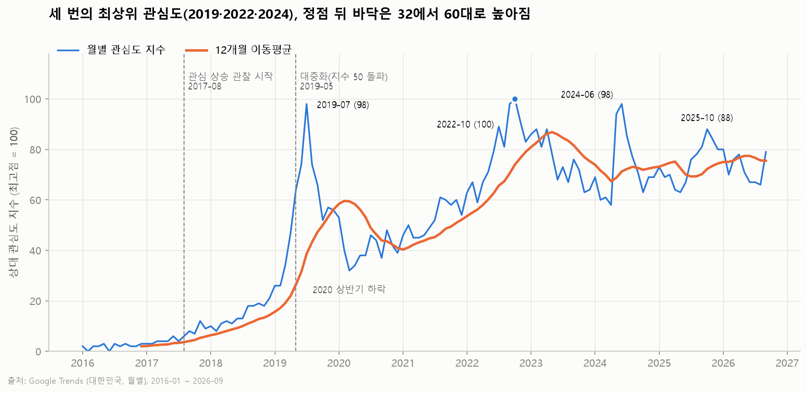
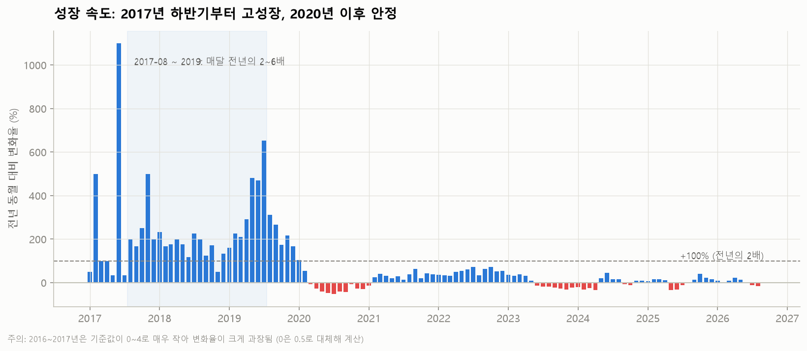
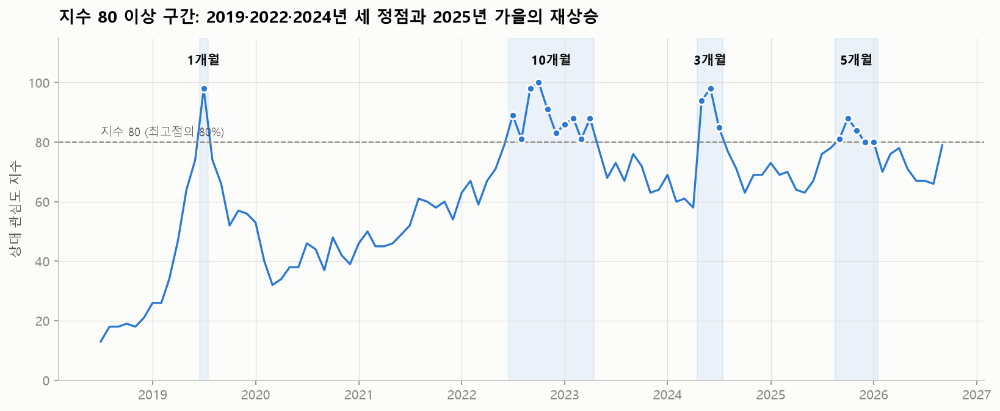
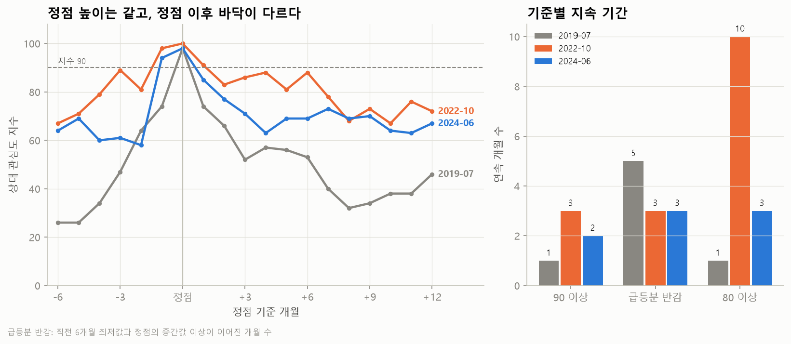
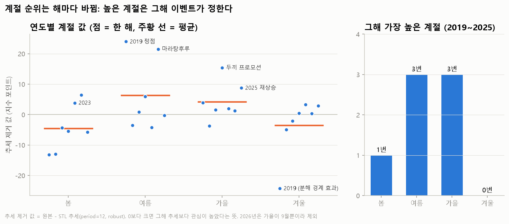
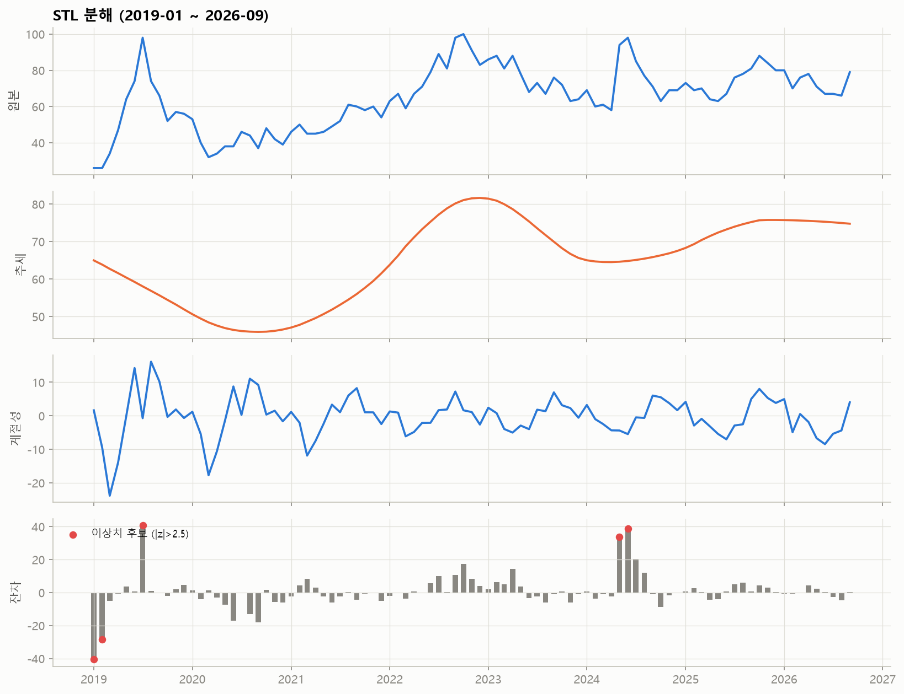

# Google Trends로 살펴본 한국 마라탕 유행의 확산과 재유행 요인: 2019·2022·2024년 정점 비교

> **[직접 작성]** 표시는 본인이 확인한 근거나 판단으로 채워야 하는 부분입니다. 제출 전에 이 줄과 함께 지워 주세요.

## 1. 분석 주제 및 선정 이유

- 마라탕은 2010년대 후반 한국에서 빠르게 대중화된 뒤, 한 번 반짝하고 사라지지 않고 **2019년, 2022년, 2024년 세 번에 걸쳐 비슷한 수준(지수 98·100·98)의 최상위 관심도**를 기록했다.
- 이 리포트는 "언제 가장 유행했는가"가 아니라 **세 번의 정점이 각각 어떻게 만들어졌고, 얼마나 유지됐으며, 그 사이 관심이 어떻게 이어졌는가**를 Google Trends 검색 관심도로 확인한다.
- 마라탕을 좋아해서, 내가 즐겨 먹는 음식이 언제부터 이렇게 인기를 얻었고 지금도 인기가 이어지고 있는지 직접 확인해 보고 싶었다.

## 2. 분석 질문

1. **언제부터** 마라탕에 대한 관심도가 오르기 시작했나?
2. **최상위 관심도는 언제 나타났고, 왜 그렇게 됐으며, 얼마나 유지됐나?** (2019·2022·2024년 세 정점 비교)
3. **계절별로** 관심도에 차이가 있나? 마라탕에 대한 관심은 **꾸준히 유지되고** 있나?

## 3. 데이터 설명

| 항목 | 내용 |
|---|---|
| 출처 | Google Trends (검색어 "마라탕", 대한민국, 월별) |
| 원본 기간 | 2015-12 ~ 2026-09 (130개월) |
| 분석 기간 | 2016-01 ~ 2026-09 (**129개 데이터 포인트**) |
| 컬럼 | `Time` (월 첫날), `마라탕` (상대 관심도 지수, 정수) |
| 값의 의미 | 검색 **횟수가 아니라** 조회 기간 중 가장 높은 달을 100으로 둔 상대 지수. 값 50은 100인 달의 절반 수준의 관심이라는 뜻 |

**집계 단위를 월별로 한 이유:** Google Trends는 조회 기간이 5년을 넘으면 월 단위로만 데이터를 제공한다. 10년 이상의 장기 흐름과 여러 정점을 비교하는 것이 목적이므로 월 단위가 적절하다. 다만 주 단위의 짧은 급등은 월평균에 묻힐 수 있다(한계점 참고).

## 4. 데이터 정제

| 항목 | 확인 결과 | 처리 기준 |
|---|---|---|
| 기간 | 2015-12 ~ 2026-09 | 2015-12는 한 달뿐이라 연도 단위 비교를 위해 제외. 2026년은 9개월치라 연평균 비교 시 따로 표시 |
| 결측치 | 없음, 누락된 달 없음, 중복 날짜 없음 | 처리 불필요 |
| 0 값 | 2016-02, 2016-06 두 번 | Google Trends의 0은 "검색 없음"이 아니라 "데이터 부족(1 미만)"이라는 뜻이다. 원본 값은 그대로 두고, **변화율 계산에서만 0.5로 대체**해 0으로 나누는 문제를 막았다 |
| 이상치 | STL 잔차의 z-score가 2.5를 넘는 달: 2019-01, 2019-02, 2019-07, 2024-05, 2024-06 | 입력 오류가 아니라 실제 관심의 급변이므로 **제거하지 않고 표시만** 했다. 2019-07과 2024-05~06은 분석 대상인 정점 그 자체다. 2019-01·02는 붐 직전 급상승을 STL 추세가 따라가지 못해 생긴 분해 경계 효과로 판단했다 |

## 5. 적용한 시계열 분석 기법

| 기법 | 왜 썼나 | 어디에 썼나 |
|---|---|---|
| **12개월 이동평균 (MA12)** | 한 해 전체를 평균하면 계절 효과와 한 달짜리 급등이 상쇄되어 큰 흐름(추세)만 남는다 | 그래프 1, Q3 유지 여부 판단 |
| **전년 동월 대비 변화율 (YoY)** | 같은 달끼리 비교하므로 계절 효과 없이 성장 속도만 볼 수 있다 | 그래프 2, Q1 상승 시작 시점 판단 |
| **연도별 구간 통계** | 평균, 표준편차, 최소, 최대로 해마다 수준과 출렁임을 비교한다 | Q3 유지 여부 |
| **임계값 기반 지속 기간** | 정점 수준이 몇 달 연속 이어졌는지 센다. 기준 하나에 결과가 끌려가지 않도록 세 가지 기준(90 이상, 급등분 반감, 80 이상)을 같이 썼다 | 그래프 3·6, Q2 |
| **정점 정렬 비교** | 세 정점을 "정점 = 0개월"로 맞춰 겹쳐서, 시기가 다른 정점의 상승·하락 모양을 직접 비교한다 | 그래프 6, Q2 |
| **STL 분해 (보너스 A)** | 원본에서 추세를 빼야 순수한 계절 차이를 볼 수 있다. `robust=True`로 급등의 영향을 줄였다 | 그래프 5 |
| **연도별 계절 비교** | STL 계절 성분은 "매년 같은 패턴이 반복된다"고 가정한 값이다. 그래서 연도별로 `원본 − STL 추세`를 계절마다 평균 내서, 같은 계절이 해마다 높은지 직접 확인했다 | 그래프 4, Q3 계절성 |

## 6. 분석 결과 및 시각화

### Q1. 언제부터 관심도가 오르기 시작했나?

"붐의 시작"을 감으로 정하지 않으려고 두 가지 기준을 세웠다.

- **관심 상승 관찰 시작:** 전년 동월 대비 +100% 이상(전년의 2배 이상)이 **6개월 연속** 이어진 첫 달 → **2017-08**
- **대중화:** 지수가 처음 50을 넘은 달 → **2019-05** (지수 64)

단, 2016~2017년 값은 0~12로 매우 작다. Google Trends는 검색량이 적은 구간에서 0 처리와 표본 노이즈의 영향을 크게 받는다. 그래서 2017-08은 정확한 "유행 시작일"이 아니라 **대중 노출이 본격적으로 관찰되기 시작한 시기**로 해석한다.

**관찰**
- 연평균 지수는 2016년 2.0 → 2017년 5.8 → 2018년 14.3 → 2019년 56.2로, 3년 동안 매년 2~4배씩 커졌다.
- 2017-08부터 2019년까지 거의 매달 전년의 2~6배 수준이었다(그래프 2의 음영 구간).
- 2019-01(26)에서 2019-07(98)까지 6개월 만에 약 4배로 뛰었다.
- 2020-03 이후 전년 대비 변화율은 −53% ~ +72% 범위로 좁아졌다. 2023년 하반기부터는 대부분 ±40% 안쪽이다. 성장기가 끝나고 안정기로 들어간 것이다.

**2017년의 근거**
- **중국인 상권에서 먼저 형성:** 2017년 1월 기사는 서울 대림동을 중국인이 많이 사는 신흥 차이나타운으로 소개하면서, 그곳의 마라탕 전문점을 다뤘다. 채소·면·두부를 직접 고르고, 무게로 값을 매기고, 매운 단계를 고르는 방식이었다. 당시에는 아직 "대림동 미식여행의 이색 중국 음식"에 가까웠다 (트래블바이크뉴스, 「'입 안이 얼얼' 대림동 차이나타운 마라탕맛집」, 2017-01). 2017년 11월 〈생활의 달인〉에 나온 가게의 한 손님은 "중국 유학을 했던 사람이나 중국 사람들만 먹는 로컬식 음식이었는데, 이 집이 대중화 시켰다"고 말했다 (한국일보, 2017-11-13).
- **지상파 방송 노출:** 2017년 7월 KBS2 〈VJ특공대〉가 사천식 마라탕집을 "이열치열 중국식 매운맛"으로 소개했다 (베리타스알파, 「'VJ특공대' '이열치열' 더운여름 맵고 얼얼한 중국…」). 2017년 11월에는 SBS 〈생활의 달인〉이 마라탕·마라샹궈 전문점을 소개했다.
- **데이터와의 시기:** 2017-08 6 → 9월 8 → 10월 7 → 11월 12. 〈생활의 달인〉이 방영된 11월이 2017년 중 가장 높은 달이다.

**해석**
- 관심은 2019년에 갑자기 생긴 것이 아니라 **2017년 하반기부터 약 2년간 서서히 쌓이다가** 2019년 상반기에 대중화 문턱을 넘은 것으로 보인다.
- 확산 과정은 이렇게 정리할 수 있다: 2016년 이전 중국인·유학생 상권 중심 → 2017년 대림동 맛집과 지상파 방송을 통한 대중 소개 → 2018년 대학가·일반 상권으로 점진적 확산 → 2019년 유튜브 먹방·SNS와 결합하며 전국적 유행.
- 방송이 상승의 유일한 원인이라고 증명할 수는 없다. 다만 방송이 대중 노출을 넓혔다는 **시간적 근거**는 충분하다.
- 맵고 뜨거운 국물을 좋아하는 한국인 입맛에 맞았기 때문에, 노출이 늘었을 때 일회성 호기심으로 끝나지 않고 확산 흐름을 탔다고 본다. 이 부분은 데이터로 검증한 것이 아니라 **본인의 가설**이다.
- 2019년 상반기의 급상승은 실제 소비 증가와 같은 시기에 일어났다. 2019년 1~5월 위메프에서 마라탕 재료 매출은 전년 동기 대비 9,502%, 마라샹궈 재료 매출은 4,011% 늘었다 (톱데일리). 자세한 내용은 Q2의 2019년 정점 참고.

### Q2. 최상위 관심도는 언제 나타났고, 왜 그렇게 됐으며, 얼마나 유지됐나?

#### Q2-1. 세 번의 비슷한 최상위 관심도

마라탕 검색 관심도에는 **2019-07(98), 2022-10(100), 2024-06(98)** 세 번의 정점이 있다. Google Trends 지수는 표본으로 계산한 정수 값이라 2포인트 차이는 의미 있게 보기 어렵다. 그래서 2022-10을 "유일한 최고점"으로 보기보다는 **세 시기에 같은 수준의 최상위 관심도에 도달했다**고 보는 것이 정확하다.

#### Q2-2. 세 정점의 지속 기간 비교

지속 기간은 기준에 따라 결과가 달라진다. 그래서 세 가지 기준을 같이 봤다.

- **90 이상:** 정점 수준 그 자체가 이어진 연속 개월 수
- **급등분 반감:** 직전 6개월 최저값과 정점의 중간값 이상이 이어진 연속 개월 수. 바닥 높이와 상관없이, 정점을 만든 추가 관심이 얼마나 갔는지를 본다
- **80 이상:** 높은 관심 구간 전체가 이어진 연속 개월 수

| | 2019-07 | 2022-10 | 2024-06 |
|---|---|---|---|
| 정점 값 | 98 | 100 | 98 |
| 직전 바닥 (6개월 내 최저) | 26 (2019-01) | 67 (2022-04) | 58 (2024-04) |
| 상승 기간 (직전 바닥 → 정점) | 6개월 | 6개월 | **2개월** |
| **90 이상 유지** | 1개월 | 3개월 | 2개월 |
| **급등분 반감 기준 이상 유지** | 5개월 (기준 62) | 3개월 (기준 83.5) | 3개월 (기준 78) |
| **80 이상 유지** | 1개월 | **10개월** | 3개월 |
| 3개월 뒤 유지율 | 53% | 86% | 72% |
| 정점 이후 12개월 내 바닥 | 32 (2020-03) | 67 (2023-08) | 63 (2024-10) |
| 정점 당시 12개월 이동평균 | 38.6 | 74.0 | 71.2 |

**관찰**
- **최상위 수준(90 이상)은 세 번 모두 1~3개월로 짧고 비슷하다.** 정점을 만든 추가 관심(급등분 반감 기준)도 3~5개월 안에 사라졌다.
- 차이는 **정점 아래의 바닥**에서 난다. 2019년은 26에서 출발해 정점 이후 32까지 내려갔다. 2022년과 2024년은 60대에서 출발해 정점 이후에도 60대에 머물렀다.
- 2022년의 80 이상 10개월은 정점 자체가 길었다기보다, **바닥(67)이 이미 80에 가까웠기 때문에** 길게 나온 것이다. 같은 기간 90 이상은 3개월이다.
- 상승 모양도 다르다. 2019년은 6개월에 걸쳐 26 → 98로 꾸준히 올랐다. 2022년은 6개월에 걸쳐 67 → 100으로 올랐다. 2024년은 한 달 만에 58 → 94(+62.1%)로 뛰었고, 두 달 만에 98(+69.0%)이 됐다.

#### Q2-3. 각 정점의 원인

**① 2019-07 (98): 처음 대중적으로 폭발한 시기** (확산형: 낮은 바닥에서 6개월간 상승, 정점은 1개월)

- **관찰:** 2019-06 74 → 2019-07 98. 2019-01(26)부터 6개월 연속 상승했다.
- **근거:** 2019년 1~5월 위메프 판매 자료에서 마라탕 재료 매출이 전년 동기 대비 9,502%, 마라샹궈 재료 매출이 4,011% 늘었다. 같은 시기 유튜브 먹방·ASMR에 나온 이색 음식의 판매량이 크게 늘었다 (톱데일리, 「먹방, ASMR에서 유행한 음식 매출 급증」).
- **해석:** 유튜브 먹방, 중국당면·분모자 같은 시각적인 재료, 원하는 재료를 직접 고르는 방식이 SNS와 결합하면서 처음 대중화됐을 가능성이 크다. 매출도 함께 폭증했으므로, 검색만 늘어난 것이 아니라 실제 소비도 함께 늘어난 시기로 볼 수 있다.

**② 2022-09 ~ 10 (98 → 100): 수요 정착 + 공급 확대 + 프로모션** (누적형: 높은 바닥 위에 쌓인 정점, 고점권 10개월)

- **관찰:** 2022-08 81 → 9월 98 → 10월 100 → 11월 91. 2022-07 ~ 2023-04에 지수 80 이상이 10개월 이어졌다.
- **근거 1 (수요):** 배민의 2021년 주문 데이터에서 마라탕은 10대가 가장 많이 주문한 음식 1위였다. 2위는 매운 떡볶이, 3위는 치킨버거였다 (전자신문, 배민트렌드 2022). KB국민카드의 2019~2022년 학생 체크카드 분석에서도 여학생의 음식점 지출에서 마라탕 전문점 선호가 강하게 나타났다. 관련 검색 이용자는 여성 73%, 10대와 20대가 각각 약 28%였다 (서울경제, 「MZ 女 73%…떡볶이 말고 마라탕」).
- **근거 2 (공급):** 2022년 상호에 '마라'가 들어간 음식점이 980곳 새로 문을 열었다. '마라' 관련 프랜차이즈 가맹점은 2020년 377곳에서 2022년 1,619곳으로 약 4.29배, '마라탕' 상호 가맹점은 279곳에서 1,066곳으로 약 4배 늘었다 (헤럴드경제, 행정안전부·공정거래위원회 자료 인용).
- **근거 3 (시기가 겹친 사건):** 두끼가 2022-09-20 ~ 10-31에 마라탕 재료와 소스 무한리필 한정 프로모션을 진행했다 (신아일보, 「두끼 '마라탕도 무한리필'」). 같은 기간 Google Trends 관련 검색어에서 "두끼"는 +3,750%, "두끼 마라탕"은 +3,250% 급상승했다. 지수가 90 이상이었던 2022-09 ~ 11과 프로모션 기간이 거의 일치한다.
- **해석:** 10대·여학생 중심의 강한 수요가 이미 형성된 상태에서 점포와 프랜차이즈가 급증해 접근성이 높아졌다. 여기에 두끼의 9~10월 한정 프로모션과 방송·SNS 노출이 겹치면서 검색 관심도가 최상위 수준에 도달한 것으로 추정된다. 두끼 프로모션은 시기와 관련 검색어가 모두 맞는 유력 요인이지만, **단독 원인이라고 단정할 수는 없다.** 앞의 지속 기간 비교도 이 해석과 맞는다. 90 이상 구간(3개월)은 프로모션 기간과 겹치고, 80 이상이 10개월 이어진 것은 수요와 공급이 만든 높은 바닥 덕분이다.

**③ 2024-05 ~ 06 (94 → 98): '마라탕후루' 챌린지** (이벤트형: 한 달 만에 급등, 3개월 만에 원래 수준으로)

- **관찰:** 2024-04 58 → 5월 94 → 6월 98 → 7월 85. 4월 대비 5월 +62.1%, 6월 +69.0%. 2024-10에는 63으로 돌아왔다.
- **근거:** 서이브의 노래 〈마라탕후루〉가 2024-04-17에 발매됐다. 5월 초부터 틱톡·유튜브·릴스 챌린지로 퍼졌고, 5월 7일 기준 틱톡 뮤직비디오 조회수 약 370만 회, 여러 인플루언서의 챌린지 영상 약 200만 회, 틱톡 뮤직 1위를 기록했다 (뉴시스, 「2012년생이 쏘아올린 챌린지…마라탕후루」 / 서울신문, 「침착맨도 따라한 마라탕후루」 / 이투데이, 「마라탕후루 챌린지 인기」).
- **해석:** 발매와 숏폼 챌린지 확산 직후 '마라탕' 검색 관심도가 급격히 올랐다. 2024년 정점은 음식 자체의 새로운 유행이라기보다, **이미 인기 있는 음식이 노래와 밈의 소재가 되면서 검색 관심이 다시 살아난 현상**으로 볼 수 있다. 세 정점 중 상승이 가장 빠르고(2개월), 이후 원래 수준(60대)으로 빠르게 돌아온 것도 일회성 이벤트의 모양과 맞는다. 다만 '마라탕후루'라는 단어에 '마라탕'이 들어 있으므로, 음식이 아니라 노래를 찾는 검색이 섞였을 수 있다(한계점 참고).

### Q3. 계절별 차이가 있나? 관심은 꾸준히 유지되고 있나?

#### Q3-1. 계절별 차이

**방법**
- 원본 값을 그대로 계절별로 평균 내면 상승 추세 때문에 뒤쪽 계절이 높게 나온다. 그래서 STL로 추세를 먼저 구했다 (2019-01 ~ 2026-09).
- STL의 계절 성분은 "매년 같은 패턴이 반복된다"는 가정으로 매끄럽게 만든 값이다. 이것만 보면 가을 +4.2, 봄 −6.0처럼 일정한 계절성이 있는 것처럼 보인다. 그래서 **연도별로** `원본 − STL 추세`를 계절마다 평균 내서, 같은 계절이 해마다 높은지 직접 확인했다.
- 비교 기간은 2019 ~ 2025년(7개 연도)이다. 2016~2018년은 지수가 0~21로 작아 반올림 오차가 크고, 2026년은 가을이 9월 한 달뿐이라 제외했다. 계절 구분은 봄(3~5월), 여름(6~8월), 가을(9~11월), 겨울(같은 해의 12·1·2월)이다.

**연도별 추세 제거 값 (지수 포인트, +면 그해 추세보다 높음)**

| 연도 | 봄 | 여름 | 가을 | 겨울 | 가장 높은 계절 | 그해 이벤트 |
|---|---|---|---|---|---|---|
| 2019 | −13.2 | **+24.0** | +3.9 | −24.2 | 여름 | 7월 첫 정점 (겨울 −24.2는 분해 경계 효과) |
| 2020 | −13.0 | **−3.5** | −3.7 | −4.9 | 여름 | 상반기 하락 |
| 2021 | −4.3 | +0.8 | **+1.6** | −2.1 | 가을 | |
| 2022 | −5.4 | +5.9 | **+15.4** | +0.4 | 가을 | 9~10월 두끼 프로모션 |
| 2023 | **+3.8** | −4.2 | +2.0 | +3.3 | 봄 | |
| 2024 | +6.4 | **+21.5** | +1.3 | +0.3 | 여름 | 5~6월 마라탕후루 |
| 2025 | −5.8 | −0.3 | **+8.8** | +2.9 | 가을 | 9~10월 재상승 |
| **중앙값** | **−5.4** | **+0.8** | **+2.0** | **+0.3** | | |

**관찰**
- 원본 평균만 보면 여름(69.8)과 가을(68.9)이 봄(61.0)·겨울(61.3)보다 높다.
- 그런데 연도별로 보면 **가장 높은 계절이 해마다 바뀐다.** 여름 3번, 가을 3번, 봄 1번이다. 봄이 가을보다 높았던 해도 2년(2023, 2024) 있다.
- 각 계절이 크게 높았던 해는 **그 계절에 이벤트가 있던 해**와 겹친다. 여름은 2019년(+24.0)과 2024년(+21.5), 가을은 2022년(+15.4)과 2025년(+8.8)이다.
- 이벤트가 있던 해를 빼면 차이가 거의 없다. 중앙값은 여름 +0.8, 가을 +2.0, 겨울 +0.3이다.
- 봄은 7년 중 5년이 음수(중앙값 −5.4)로 조금 낮은 편이다. 다만 가장 낮았던 2019년(붐 직전 급상승 구간)과 2020년(상반기 하락)은 계절보다 다른 이유가 커 보이고, 2023·2024년에는 오히려 높았다.
- 여름 급등 뒤의 가을 값은 2019년 +3.9, 2024년 +1.3이다. **급등 이후 가을에 바로 추세 수준으로 돌아왔다.**

**해석**
- **마라탕 관심도에는 뚜렷한 계절성이 없다.** 계절 평균의 차이는 "그해 어느 계절에 이벤트가 있었느냐"가 만든 것이다. "여름(또는 가을)이라서 높다"고 말하는 것은 비약이다.
- 원본 평균에서 가을이 높게 나온 것도 여름 급등의 여운이라기보다, 2022년(두끼 프로모션)과 2025년의 **가을 자체 상승** 때문이다. 여름 급등이 있던 해의 가을은 거의 추세 수준이었다.
- 마라탕이 "더운 여름의 이열치열 음식"이나 "쌀쌀한 계절의 국물 음식"으로 소비된다면 같은 계절이 매년 높아야 한다. 그런 패턴은 보이지 않으므로, 마라탕은 **계절을 타지 않는 일상 메뉴**에 가깝다고 본다.

#### Q3-2. 관심이 꾸준히 유지되고 있나?

| 연도 | 연평균 | 전년 대비 | 표준편차 |
|---|---|---|---|
| 2019 | 56.2 | +293.0% | 21.2 |
| 2020 | 40.9 | −27.2% | 6.0 |
| 2021 | 52.2 | +27.6% | 6.3 |
| 2022 | 79.0 | +51.3% | 13.7 |
| 2023 | 75.3 | −4.7% | 9.0 |
| 2024 | 72.8 | −3.3% | 13.2 |
| 2025 | 74.4 | +2.2% | 8.0 |
| 2026 (1~9월) | 72.7 | −2.3% | 5.6 |

**관찰**
- 2023년 이후 연평균은 **72.7 ~ 75.3** 사이로, 4년 가까이 거의 같은 수준이다.
- 12개월 이동평균은 2023-05에 86.8로 가장 높았다. 이후 2024-04에 67.4까지 내려간 뒤 다시 올라 2026-09 현재 **75.5** 다.
- 2023-01 이후 월별 지수는 평균 73.9, 표준편차 9.3이며 가장 낮은 달도 58이다.
- 세 정점 이후의 바닥은 32(2020-03) → 67(2023-08) → 63(2024-10)이다. 2019년 정점 뒤에는 크게 꺼졌지만, 2022년과 2024년 정점 뒤에는 60대에서 멈췄다.
- 2025-09 ~ 2026-01에도 지수 80 이상(정점 88)이 5개월 이어졌다. 세 정점만큼 높지는 않지만, 2024년 정점 이후에도 관심이 다시 올라온 구간이다.
- 공급 쪽도 계속 늘었다. 상호에 '마라'가 들어간 음식점은 2021년 735곳, 2022년 980곳이 새로 문을 열었고, 2023년에도 약 900곳이 새로 생겼다 (헤럴드경제, 2024-04-19).

**해석**
- 2019년 붐 직후 2020년에 크게 꺾였지만 다시 회복했고, 2023년 이후로는 **지수 70대 중반에서 안정적으로 유지**되고 있다. 정점 뒤 바닥이 60대로 올라온 것은, 2022년의 가맹점 약 4배 증가와 2023년의 신규 개업처럼 **수요와 공급이 함께 자리 잡아 마라탕이 일상 메뉴가 됐다**는 해석과 맞는다.
- 성장률(YoY)은 0 근처로 수렴했다. 폭발적으로 커지는 단계는 지났고, **높은 수준을 유지하면서 이벤트가 있을 때마다 다시 최상위 관심도에 도달하는 성숙 시장**으로 볼 수 있다.
- **[직접 작성]** 2020년 상반기 하락(2019-12의 56에서 2020-03의 32로)의 원인 가설과 근거 (예: 코로나19로 외식이 줄어든 시기와 겹치는지)

## 7. 인사이트

### 인사이트 1. 마라탕 붐은 2년에 걸쳐 쌓인 결과였다

- **관찰(Fact):** 전년 대비 2배 이상 성장이 2017-08부터 이어졌고, 지수가 50을 넘은 것은 21개월 뒤인 2019-05다. 연평균은 2016년 2.0에서 2019년 56.2로 약 28배가 됐다.
- **원인(Why):** 대림동 같은 중국인 상권에서 먼저 식당이 자리 잡았고, 2017년 7월 〈VJ특공대〉와 11월 〈생활의 달인〉 같은 지상파 방송으로 대중에게 소개됐다. 2017년 중 가장 높은 달(11월, 12)이 〈생활의 달인〉 방영 시기와 겹친다. 이후 2019년 상반기에 유튜브 먹방·ASMR 노출과 함께 위메프 마라탕 재료 매출이 전년 대비 9,502% 늘면서, 검색과 실제 소비가 같이 커졌다. 맵고 뜨거운 맛이 한국인 입맛에 맞았다는 점도 확산을 도왔다고 본다(가설).
- **행동(Action):** 비슷한 신규 음식 트렌드를 일찍 알아보려면, 절대 수준보다 **"전년 대비 2배 이상 성장이 6개월 이상 이어지는가"** 를 신호로 볼 수 있다. 다른 음식(예: 탕후루) 검색어에도 같은 기준을 적용해 검증해 볼 수 있다.

### 인사이트 2. 세 번의 최상위 관심도는 높이도, 지속 기간도 비슷했다. 달라진 것은 바닥이다

- **관찰(Fact):** 세 정점의 값은 98 · 100 · 98이고, 90 이상 유지 기간은 1 · 3 · 2개월이다. 반면 정점 이후 12개월 내 바닥은 32 → 67 → 63, 정점 당시 12개월 이동평균은 38.6 → 74.0 → 71.2로 크게 달랐다.
- **원인(Why):** 2019년에는 대중화 초기라 정점이 지나자 관심이 많이 빠졌다. 2022년까지 10대 수요가 정착하고(배민 10대 주문 1위) 가맹점이 약 4배로 늘면서 바닥 자체가 높아졌다. 그래서 2022년과 2024년에는 정점이 지나도 60대에 머물렀다.
- **행동(Action):** 트렌드를 평가할 때 한 달 최고값만 보면 세 시기가 "똑같은 유행"처럼 보인다. **정점 이후의 바닥과 이동평균**을 같이 봐야 유행이 일시적인지 정착했는지를 구분할 수 있다.

### 인사이트 3. 세 정점은 만들어진 방식이 다르다: 확산형, 누적형, 이벤트형

- **관찰(Fact):** 상승 기간은 6 · 6 · 2개월, 3개월 뒤 유지율은 53% · 86% · 72%, 지수 80 이상 유지는 1 · 10 · 3개월이다.
- **원인(Why):**
  - 2019년은 먹방·SNS를 통한 **확산형**이다. 낮은 바닥에서 반년간 올랐다가 빠르게 내려왔다.
  - 2022년은 정착한 수요와 늘어난 점포 위에 두끼 프로모션(2022-09-20 ~ 10-31)이 겹친 **누적형**이다. 90 이상 구간이 프로모션 기간과 거의 일치하고, 높은 바닥 덕분에 고점권이 10개월 갔다.
  - 2024년은 〈마라탕후루〉 챌린지라는 **이벤트형**이다. 발매 한 달 만에 급등했고, 3~4개월 만에 원래 수준으로 돌아왔다.
- **행동(Action):** 같은 높이의 정점이라도 원인에 따라 지속성이 다르다. 프로모션이나 밈으로 생긴 급등은 2~3개월짜리로 보고 계획하는 것이 안전하다. 장기적인 관심은 수요층과 점포 접근성 같은 기반에서 나온다. 2022년의 경우 두끼 프로모션 기간 전후로 지수를 비교하면 프로모션의 순효과를 더 정확히 추정해 볼 수 있다.

### 인사이트 4. 마라탕은 계절을 타지 않는다. 높은 계절은 그해 이벤트가 정한다

- **관찰(Fact):** 원본 평균으로는 여름(69.8)과 가을(68.9)이 높아 보인다. 하지만 2019~2025년 중 가장 높은 계절은 여름 3번, 가을 3번, 봄 1번으로 해마다 바뀌었다. 크게 높았던 경우는 모두 이벤트가 있던 해다(여름 2019 +24.0, 2024 +21.5 / 가을 2022 +15.4, 2025 +8.8). 이벤트의 영향을 줄인 중앙값은 여름 +0.8, 가을 +2.0으로 거의 0이다.
- **원인(Why):** 계절 차이처럼 보이는 것은 대중화(2019), 두끼 프로모션(2022), 마라탕후루(2024) 같은 이벤트가 어느 계절에 있었느냐의 결과다. 마라탕이 특정 계절 음식이 아니라 일 년 내내 먹는 일상 메뉴가 됐기 때문으로 본다.
- **행동(Action):** 원본 계절 평균만 보고 "여름(가을)이 성수기"라고 판단하면 안 된다. 같은 계절이 매년 높은지 **연도별로 나눠서** 확인해야 한다. 마라탕은 계절보다 프로모션·콘텐츠 같은 이벤트 시기에 맞춰 대응하는 편이 맞다.

### 인사이트 5. 마라탕은 반짝 유행이 아니라 정착한 메뉴다

- **관찰(Fact):** 2023 ~ 2026년 연평균은 72.7 ~ 75.3으로 거의 변하지 않았다. 12개월 이동평균은 2026-09 기준 75.5다. 2025-09 ~ 2026-01에도 80 이상이 5개월 이어졌다.
- **원인(Why):** '마라' 관련 프랜차이즈 가맹점이 2020년 377곳에서 2022년 1,619곳으로 늘었고, 2023년에도 '마라' 음식점이 약 900곳 새로 생겼다. 공급 기반이 넓게 깔려 있고 계속 늘고 있다. 10대 중심의 수요도 꾸준히 이어지는 것으로 보인다.
- **행동(Action):** 앞으로는 "얼마나 더 커질까"보다 **"이 수준이 유지되는가"**를 지켜보는 것이 의미 있다. 12개월 이동평균이 2024년 저점(67.4) 아래로 내려가면 관심이 줄어드는 신호로 볼 수 있다.

## 8. 결론 및 한계점

### 결론

1. 마라탕 관심은 **2017년 하반기부터 대중 노출이 본격적으로 관찰되기 시작해 2019년 상반기에 대중화**됐다. 대림동 등 중국인 상권에서 시작해 지상파 방송, 대학가, 유튜브 먹방·SNS로 확산된 흐름과 시기가 맞는다.
2. 마라탕은 **2019-07(98), 2022-10(100), 2024-06(98) 세 시기에 비슷한 수준의 최상위 관심도**를 기록했다. 최상위 수준(90 이상)은 세 번 모두 1~3개월로 짧았다. 세 정점은 각각 먹방·SNS 확산, 수요 정착·점포 확대·두끼 프로모션, 〈마라탕후루〉 챌린지와 시기가 맞는다.
3. **뚜렷한 계절성은 없다.** 가장 높은 계절은 해마다 바뀌었고, 그해 이벤트가 있던 계절이 높았다. 정점 이후의 바닥은 32에서 60대로 높아졌고, 2023년 이후 연평균은 70대 중반에서 유지되고 있다. 마라탕은 **계절을 타지 않고 높은 관심을 유지하면서, 이벤트가 있을 때마다 다시 최상위 관심도에 도달하는 정착한 시장**이다.

### 한계점

- **상대 지수의 한계:** 검색 횟수가 아니라 상대 지수이므로 "몇 명이 검색했는지"는 알 수 없다. 98과 100의 차이도 표본 오차 수준일 수 있어서, 이 리포트는 세 정점을 같은 수준으로 봤다.
- **검색 관심 ≠ 실제 소비:** 검색이 늘었다고 실제로 많이 먹었다는 뜻은 아니다. 이미 익숙해진 음식은 검색 없이 소비될 수 있어서, 성숙기의 관심도는 실제 소비보다 낮게 잡힐 수 있다.
- **'마라탕후루' 검색 혼입:** 2024년 정점에는 음식이 아니라 노래를 찾는 검색이 섞였을 수 있다. "마라탕후루" 검색어를 따로 받아 비교하면 이 부분을 일부 분리할 수 있다.
- **정점 이후 바닥 비교의 한계:** 2019년 정점 이후 12개월(2020-03 바닥 32)은 코로나19 시기와 겹친다. 2019년 정점 뒤의 큰 하락이 유행이 식어서인지, 외부 충격 때문인지는 이 데이터만으로 구분할 수 없다.
- **외부 근거의 범위:** 위메프 매출은 한 플랫폼의 2019년 1~5월 자료이고, 배민 자료는 2021년 주문 기준이다. 시장 전체를 대표하지는 않는다. 두끼 관련 검색어 증가율(+3,750%)은 Google Trends의 상대 증가율이라 실제 검색량 규모는 알 수 없다.
- **원인은 추정:** 각 정점의 원인은 시기가 맞는 외부 자료로 추정한 것이다. 데이터 안에서 인과관계를 증명한 것은 아니며, 여러 요인이 함께 작용했을 수 있다.
- **단일 검색어:** "마라탕"만 봤다. "마라샹궈", 매장 이름 등 관련 검색어는 반영하지 않았다.
- **월 단위 집계:** 주 단위의 짧은 급등은 월평균에 묻힐 수 있다. 두끼 프로모션(약 6주)처럼 짧은 이벤트의 효과는 주 단위 데이터로 다시 보면 더 정확하다.
- **계절성 표본 부족:** 연도별 계절 비교에 쓴 기간은 7년이다. 한 계절에 이벤트가 한 번만 있어도 평균이 크게 바뀐다. 그래서 평균과 함께 중앙값과 연도별 값을 같이 봤다. 봄이 조금 낮은 경향(7년 중 5년 음수)이 진짜인지는 데이터가 더 쌓여야 판단할 수 있다.
- **2017년 원인의 한계:** 2017년 값(3~12)은 표본 노이즈가 커서, 방송 시기와 값이 겹치는 것을 인과관계로 볼 수는 없다. "맵고 뜨거운 맛이 한국인 입맛에 맞았다"는 부분은 데이터로 검증하지 않은 가설이다.
- **STL 경계 효과:** 분석 시작 구간(2019-01 ~ 02)은 추세가 실제 값을 따라가지 못해 큰 음(−)의 잔차가 생겼다. 이상치 후보지만 실제 이벤트가 아니라 분해 방식 때문이다.
- **재현성:** Google Trends는 다시 내려받으면 값이 조금 달라질 수 있다. 이 분석은 저장소에 포함된 CSV 기준이다.

### 참고 자료

| 내용 | 출처 |
|---|---|
| 대림동 차이나타운 마라탕 전문점 소개 (2017-01) | 트래블바이크뉴스, 「'입 안이 얼얼' 대림동 차이나타운 마라탕맛집」 (최승언 기자) **[직접 작성: URL]** |
| KBS2 〈VJ특공대〉 사천식 마라탕 소개 (2017-07) | 베리타스알파, 「'VJ특공대' '이열치열' 더운여름 맵고 얼얼한 중국…」 (신승희 기자) **[직접 작성: 전체 제목, URL]** |
| SBS 〈생활의 달인〉 마라탕·마라샹궈 전문점 소개, 손님 인터뷰 (2017-11) | 한국일보, 「'생활의 달인' 마라탕-마라상궈 "칼칼한 대륙의 맛"」 (차유진 기자, 2017-11-13), https://www.hankookilbo.com/news/article/201711132140281187 |
| 2019년 1~5월 위메프 마라탕·마라샹궈 재료 매출 | 톱데일리, 「먹방, ASMR에서 유행한 음식 매출 급증」 **[직접 작성: 날짜, URL]** |
| 2021년 10대 주문 1위 마라탕 | 전자신문, 배민트렌드 2022 **[직접 작성: 날짜, URL]** |
| 학생 체크카드 분석, 검색 이용자 성별·연령 | 서울경제, 「MZ 女 73%…떡볶이 말고 마라탕」 **[직접 작성: 날짜, URL]** |
| '마라' 음식점 개업 수, 가맹점 수 변화 | 헤럴드경제, 「'마라탕후루'의 힘? 마라탕집, 작년에도 900개 생겼다 [푸드360]」 (김희량 기자, 2024-04-19, 행정안전부 인허가 자료·공정거래위원회 정보공개서 인용), https://biz.heraldcorp.com/article/3375143 |
| 두끼 마라탕 무한리필 프로모션 (2022-09-20 ~ 10-31) | 신아일보, 「두끼 '마라탕도 무한리필'」 **[직접 작성: 날짜, URL]** |
| 〈마라탕후루〉 발매와 챌린지 확산 | 뉴시스, 「2012년생이 쏘아올린 챌린지…마라탕후루」 / 서울신문, 「침착맨도 따라한 마라탕후루」 / 이투데이, 「마라탕후루 챌린지 인기」 **[직접 작성: 날짜, URL]** |
| 두끼 관련 검색어 증가율 | Google Trends 관련 검색어 (2022-09 ~ 10) |

## 9. AI 사용 로그

| 사용 작업 | 사용 이유 | 검증 방법 |
|---|---|---|
| 분석 범위 수정: 노트북이 2024-12에서 자르던 것을 원본 끝(2026-09)까지 확장하고 재실행 | 질문 3(유지 여부)에 최신 데이터가 필요했고, 수작업으로 여러 셀을 고치면 누락 위험이 있음 | 수정 후 노트북 전체를 재실행해 데이터 수(129개월)와 연도별 통계를 CSV 원본과 대조함 |
| 세 정점 지속 기간 비교 지표 설계와 그래프 6 작성 | 기준 하나(80 이상)만 쓰면 바닥이 높은 2022년이 유리하게 나와서, 대안 기준을 탐색함 | 정점 전후 월별 값을 CSV에서 직접 확인해 표의 개월 수와 대조함 |
| 그래프 라벨 위치와 제목 수정 | 가독성 개선. 제목이 데이터와 맞는지 점검 | 생성된 PNG를 직접 열어 확인. 그래프 1 제목의 "바닥이 점점 높아짐"은 실제 값(67 → 63)과 맞지 않아 수정함 |
| 계절성 분석 재검토: 연도별 계절 비교표와 그래프 4 재작성 | AI가 처음 STL 계절 성분만 보고 "가을이 높고 봄이 낮다"고 정리했는데, 본인이 원본에서 봄이 가을보다 높은 해가 있는 것을 보고 결론이 비약이라고 판단함. 이를 검증하려고 사용 | 연도별 표에서 같은 계절이 해마다 높은지 직접 확인함. 봄 > 가을인 해가 2년(2023, 2024)임을 확인했고, "여름 급등의 여운 때문에 가을이 높다"는 본인 가설도 2019·2024년 가을 값(+3.9, +1.3)으로 확인해 보니 맞지 않아 결론에서 뺌 |
| 헤럴드경제, 한국일보 기사 확인 | 인용한 수치와 발언이 원문과 맞는지 확인 | 기사 원문에서 제목, 날짜, 수치(980곳, 377 → 1,619곳, 279 → 1,066곳)를 대조함. 한국일보 손님 발언은 원문 문장으로 바꿈 |
| README.md, REPORT.md, requirements.txt 초안 작성, 직접 조사한 근거 자료의 문장 정리 | 시간 절감, 리포트 구성 누락 방지 | AI가 리포트의 수치를 노트북 출력과 대조함. 본인이 그래프 이미지와 CSV 원본 데이터 사이에 모순이 없는지 직접 확인함 |
| 초기 노트북 작성 (전처리, 시각화 1~5, 분석 기준). 이전 대화 기록이 남아 있지 않아 세부 내용은 적지 못함 | 시간 절감 | 이번 작업에서 노트북 전체를 다시 실행하고, 데이터 수·연도별 통계·정점 값을 CSV 원본과 대조함 |

**최종 판단에 대해:** 2017년 확산 배경(대림동 상권, 지상파 방송)과 세 정점의 원인 근거(위메프 매출, 배민·KB국민카드 자료, 가맹점 수, 두끼 프로모션, 마라탕후루 챌린지)는 본인이 직접 기사와 Google Trends 관련 검색어를 찾아 확인했다. "세 시기에 비슷한 수준의 최상위 관심도"라는 표현, 두끼 프로모션을 단독 원인으로 보지 않은 점, 계절성 결론을 "뚜렷한 계절성 없음"으로 고친 점도 본인이 판단했다.
